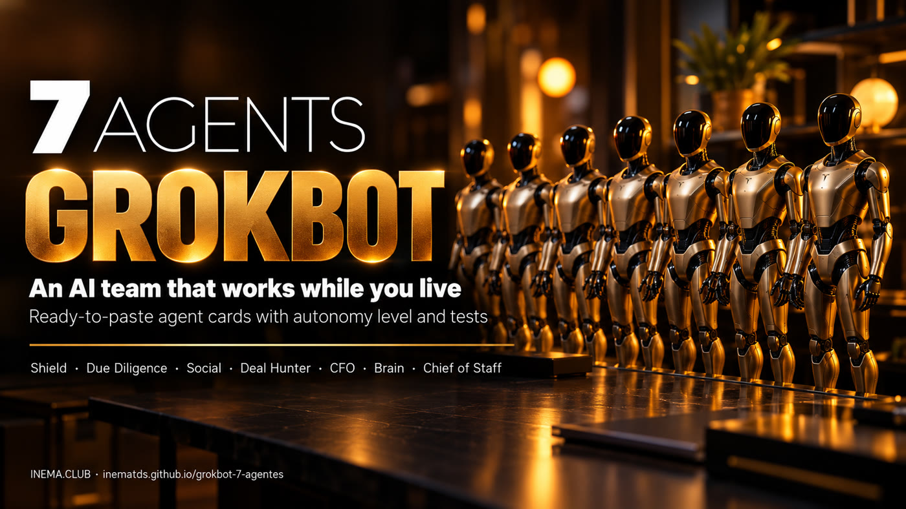

# 🦾 GrokBot 7 Agents

**🇧🇷 [Português](README.md) · 🇺🇸 [English](README.en.md) · 🇪🇸 [Español](README.es.md)**

[](https://inematds.github.io/grokbot-7-agentes/guia/en/)

## What it is

This is a kit with seven ready-made agents for people who use GrokBot, xAI's agent assistant. Each agent comes as a card: a text to paste into GrokBot, what it can and can't do on its own, three tests to run before you trust it, and a short follow-up routine. Together, they watch your email, check contracts, look after your social accounts, request quotes, review your finances, keep the team's memory, and coordinate everything. To use it, all you need is GrokBot and to connect the apps each card lists.

## 📖 User guide

Full guide (landing + step by step + instructions to copy): **https://inematds.github.io/grokbot-7-agentes/guia/en/**

## The 7 agents

| # | Agent | What it does | Level | When it runs |
|---|---|---|---|---|
| 1 | [🛡️ Shield](agentes/en/01-escudo.md) | Rescues good email from spam, flags scams, finds your phone number on people-search sites | N2 · prepares, you approve | every day at 7am |
| 2 | [🔍 Due Diligence](agentes/en/02-checagem.md) | Checks a person/company in 4 places and reads the fine print before you sign | N1 · researches and prepares | every day + on request |
| 3 | [📱 Social](agentes/en/03-redes.md) | Trends on X, posts in your voice, automatic DM by keyword | N2 · prepares, you approve | every morning + on request |
| 4 | [💸 Deal Hunter](agentes/en/04-negociador.md) | Requests 3+ quotes from its own email, compares and haggles | N2 · prepares, you approve | on request |
| 5 | [📊 CFO](agentes/en/05-financeiro.md) | Finds duplicate subscriptions, needless spending, forgotten money and the cost of each bot | N0 · read-only | every day, dashboard on Monday |
| 6 | [🧠 Brain](agentes/en/06-cerebro.md) | Team's shared memory in a database; the others only add reports, it organizes | N3 · executes | on request |
| 7 | [🤝 Chief of Staff](agentes/en/07-chefe-de-gabinete.md) | Coordinates the others and hands you the 8am summary | N3 · executes | every day at 8am |

Each card follows the INEMA **Agent Card** format ([7 principles](https://inematds.github.io/7pa/)): mission, context, data, success criteria, autonomy, observation and oversight, plus the **Ready-made instruction** to paste, **3 tests** and the **oversight checklist**.

## The process, from start to finish

Who does it: 🧑 you · ⚙️ GrokBot on its own, on schedule · 🤖 the agent, when you ask.

1. 🧑 **Pick the job that eats most of your week** (email, contracts, social, quotes or spending) and open its card in `agentes/en/`.
2. 🧑 **Copy the "Ready-made instruction"** from the card (or use the copy button in the [guide](https://inematds.github.io/grokbot-7-agentes/guia/en/#agentes)).
3. 🧑 **Paste it into a new GrokBot conversation** and replace what's in `[brackets]` with your own details. GrokBot confirms in 3 lines what it understood.
4. 🧑 **Connect the apps** the card asks for (`"I want to connect to [service]. What do you need?"`). API keys go in GrokBot's secure field.
5. 🧑 **Run the card's 3 tests** (missing information, forbidden request, alarm). Got one wrong? Adjust the rule and test again.
6. ⚙️ **The agent runs on the card's schedule** (Shield 7am, Chief 8am, CFO with a dashboard on Monday) and 🤖 on request.
7. 🧑 **2 minutes a day:** read the report and approve what's waiting for your OK. **10 minutes a week:** adjust just one rule (in the bot's conversation: *"Change one rule: ..."*) and note what broke in a spreadsheet of your own, copying the "Failure log" table from the card.
8. 🧑 **Repeat from step 1** with the next agent, a week later.
9. 🧑 **With 2+ agents running, set up the Brain** (a database that becomes the shared memory) and **connect the same database to each bot**: the instructions already tell each one to store its own report there. Then set up **the Chief of Staff**, who reads those reports and summarizes them for you at 8am.
10. 🧑 **Every month:** check that each agent's level is still the right one; raise it only when the card says you can.

## The 3-reasons rule

Create a separate bot only if it needs its own **memory**, a different **permission** or its own **clock**. Otherwise, just ask the Chief of Staff directly. Six bots are six conversations to keep up with.

## Notes

- The cards are an INEMA kit.
- We haven't tested them on every GrokBot account and plan: **run the 3 tests on yours before you trust it**.
- Tools mentioned in the cards (post scheduler, wallet, database) are examples, not requirements. None has any tie to INEMA.
- Anything that touches money or talks to outside people starts at level N2: **nothing goes out without your OK**.

## For kit maintainers

The page's instructions come from the cards. Edited a card (PT in `agentes/`, EN in `agentes/en/`, ES in `agentes/es/`) or the page (`guia/_src/<language>.html`)? Run:

```bash
python3 guia/build.py   # generates guia/index.html, guia/en/ and guia/es/
```

---

Open and free kit · [INEMA.CLUB](https://inema.club)
